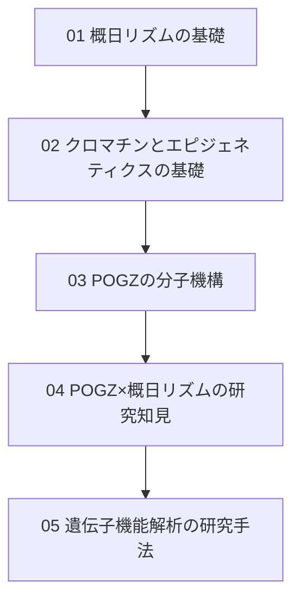

# 00. 概日リズム学習の概要

> [!abstract] 最終目標
> 「概日リズム制御におけるPogz遺伝子の機能解析」という研究テーマを理解できるレベルまで、
> 概日リズムの基礎からPOGZの分子機構・研究知見まで積み上げて学習する。
> このノートは学習の**ロードマップ兼インデックス**。進めるたびにリンクを追加していく。

---

## 🗺️ 学習マップ

---

## 📚 学習ノート一覧

1. [[01_概日リズムの基礎]] — 用語(遺伝子/mRNA/タンパク質)・SCN・時計遺伝子のループと「遅れ」・光による同調(CREB・位相反応曲線)
2. [[02_クロマチンとエピジェネティクスの基礎]] — ヘテロクロマチン・ヒストン修飾・HP1・BAF複合体・時計遺伝子とクロマチン
3. [[03_POGZの分子機構]] — ドメイン構造、HP1/esBAF/ADNPとの相互作用、「閉じる」と「開ける」の二面性
4. (未作成) POGZ×概日リズムの研究知見 — SCNでの発現・DBPによる転写制御・CREBとの相互作用・POGZ欠損マウスの表現型
5. (未作成) 遺伝子機能解析の研究手法 — ChIP-seq、KOマウス行動解析、光同調実験など、論文を読むための実験手法の理解

---

## 🔑 現在地

- 完了：1, 2, 3(2026-10-20 に対話学習の内容で 01〜03 を刷新)
- 次のステップ：4「POGZ×概日リズムの研究知見」(He et al., 2026, *JCI Insight* "Reciprocal regulation between autism risk gene POGZ and circadian clock" を軸に読む)
