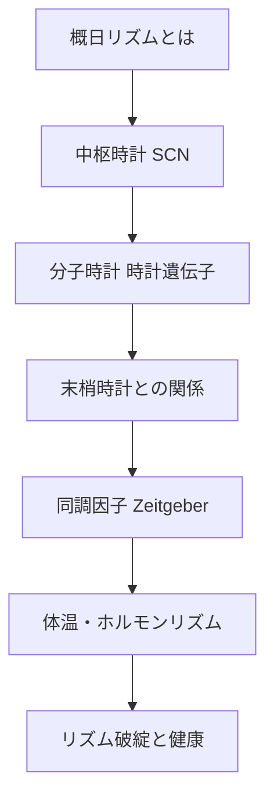

# 概日リズムの基礎

> [!note] このノートについて
> [[00_概要|概日リズム学習の概要]]の1番目。
> 概日リズム(circadian rhythm)を生物学的機構のレベルから理解するための勉強ノート。
> 中枢時計(SCN)・時計遺伝子・末梢時計・同調因子の順に積み上げていく。

## 🗺️ 学習マップ

---

## 1. 概日リズムとは

- ラテン語 *circa diem*(ほぼ1日)が語源。外部環境が一定でも約24時間周期で持続する内因性リズム
- 自由継続(free-running)周期はヒトで約24.2時間 — 外界の光に同調(entrainment)されて24時間に補正される

---

## 2. 中枢時計：視交叉上核(SCN)

- 視床下部にある左右一対の神経核。約2万個のニューロンからなる「体内時計の司令塔」
- 網膜から**網膜視床下部路(RHT)**を通じて光情報を直接受け取る
- メラノプシン含有網膜神経節細胞(ipRGC)が、錐体・杆体とは別経路で光を検出し同調に使われる

---

## 3. 分子時計：時計遺伝子の転写-翻訳フィードバックループ

- 中核は **CLOCK / BMAL1**(活性化因子)と **PER / CRY**(抑制因子)の自己抑制ループ
- CLOCK:BMAL1 が PER・CRY の転写を促進 → 蓄積したPER:CRYがCLOCK:BMAL1自身を抑制 → 分解されて再び転写開始、という約24時間周期のループ
- 第二のループとして **REV-ERBα / RORα** がBMAL1の転写量を調整し、振動を安定化

---

## 4. 末梢時計と中枢との関係

- 肝臓・心臓・脂肪組織などほぼ全身の細胞が同じ分子時計機構を持つ(末梢時計)
- SCNは末梢時計を神経・ホルモン(メラトニン・コルチゾール等)経由で統括する「指揮者」
- 末梢時計は摂食タイミングなど局所的な因子にも強く影響される → 中枢と末梢がズレる「内的脱同調」が起こりうる

---

## 5. 同調因子(Zeitgeber)

| 因子 | 強さ | 経路 |
|---|---|---|
| 光 | 最強 | 網膜→RHT→SCN |
| 食事タイミング | 中(特に末梢時計に強い) | 代謝シグナル |
| 社会的・行動スケジュール | 弱〜中 | 間接的 |
| 体温・運動 | 弱 | 間接的 |

---

## 6. 体温・ホルモンの日内変動

- 深部体温は早朝に最低、夕方〜夜に最高となる概日変動を示す
- メラトニンは松果体から夜間に分泌され、SCNからの抑制が光で解除されることで夜に上昇
- コルチゾールは起床前後にピーク(覚醒に向けた準備)

---

## 7. リズム破綻と健康への影響

- 交代勤務・時差(ジェットラグ)・不規則な光曝露はSCNと末梢時計のズレを生む
- 長期的な概日リズム破綻は代謝異常・睡眠障害・情動への影響と関連が指摘されている(今後深掘り予定)

---

## 🔑 現時点でのまとめ

> **中枢(SCN)の分子時計が光で同調し、全身の末梢時計を統率する**
> ——この一本軸から、光・食事・ホルモン・体温のリズムがすべて繋がる。

---

[[00_概要|← 概要に戻る]]
