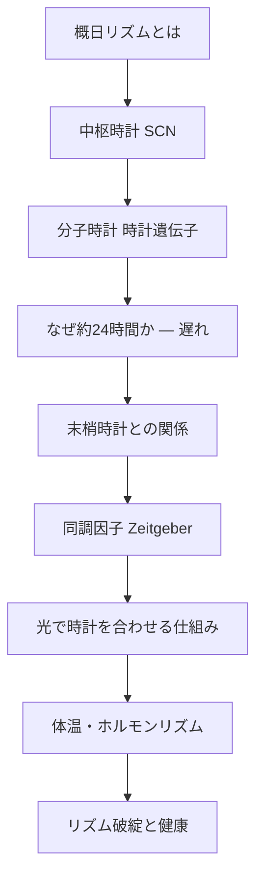
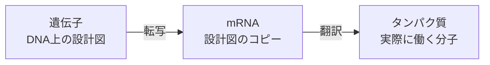
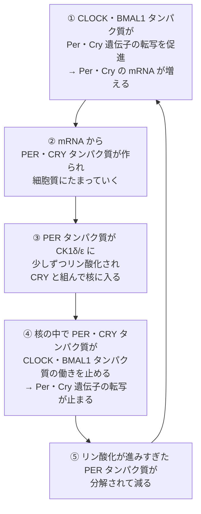
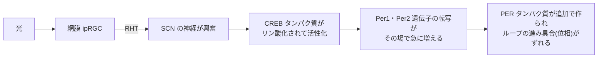

# 01. 概日リズムの基礎

> [!note] このノートについて
> [[00_概要|概日リズム学習の概要]]の1番目。
> 概日リズム(circadian rhythm)を生物学的機構のレベルから理解するための勉強ノート。
> 中枢時計(SCN)・時計遺伝子・末梢時計・同調因子の順に積み上げていく。
> 2026-10-20 に、対話形式で学んだ内容をもとに「**遺伝子 / mRNA / タンパク質のどれの話か**」が分かる粒度へ刷新した。

## 🗺️ 学習マップ

---

## 0. 用語の約束:遺伝子・mRNA・タンパク質

分子の話では「どれの話か」を必ず区別する。

| | 遺伝子・mRNA | タンパク質 |
|---|---|---|
| ヒト | ***PER2***(斜体・大文字) | **PER2**(立体・大文字) |
| マウス | ***Per2***(斜体・頭だけ大文字) | **PER2**(立体・大文字) |

- 「遺伝子の**転写**が増える」= その遺伝子の mRNA が増える
- 「タンパク質が**働く**」= 結合する・他を活性化する・止める
- 「遺伝子を壊したマウス(KO)」= 設計図がないので、そのタンパク質が作られない

> [!tip] 回路でいえば
> 遺伝子 = 回路図、mRNA = 発注された部品リスト、タンパク質 = 実装された部品。KO は回路図からその部品を消すこと。

---

## 1. 概日リズムとは

- ラテン語 *circa diem*(ほぼ1日)が語源。外部環境が一定でも約24時間周期で持続する**内因性**のリズム
- 光も時計もない地下壕でヒトを暮らさせると(1960年代のアショフらの実験など)、
  - 睡眠・覚醒のリズムは**消えない**
  - ただし周期は **約24.2時間** になり、毎日少しずつ後ろにずれていく(**自由継続 free-running**)
- つまり時間を刻んでいるのは体の中。外の光は時計そのものではなく、毎日の**時刻合わせ**(同調 entrainment)に使われる

> [!question] 最初に間違えたところ
> 「外の手がかりがなければリズムはバラバラになる」と予想した。
> 実際は消えない → **時計は外ではなく内側にある**、が出発点。

---

## 2. 中枢時計:視交叉上核(SCN)

- 視床下部にある左右一対の神経核。約2万個の神経細胞からなる「体内時計の司令塔」
- 名前の通り、左右の視神経が交差する**視交叉の真上**にある
- 網膜から **網膜視床下部路(RHT)** を通じて光情報を直接受け取る
- メラノプシン(光を感じるタンパク質)を持つ網膜神経節細胞(ipRGC)が、見るための錐体・杆体とは別経路で光を検出し、同調に使われる

**SCN が時計の本体である証拠**

| 実験 | 結果 |
|---|---|
| ハムスターの SCN を壊す | 行動リズムが消える |
| 別の個体の SCN を移植する | リズムが戻る。しかも周期は**提供した側の周期**になる(Ralph et al., 1990) |
| SCN の神経細胞を1個だけ取り出して培養する | 単独でも約24時間のリズムを刻む → **時計は細胞1個の中にある** |

> [!note] 細胞分裂とは別の仕組み
> SCN の神経細胞はもう分裂しない。それでも24時間を刻めるので、時計は細胞周期(分裂のリズム)とは別物。
> (逆に、体内時計が「分裂してよい時間帯」を制御する関係はある)

---

## 3. 分子時計:転写-翻訳フィードバックループ

### 3.1 登場するタンパク質

| タンパク質(遺伝子) | 役割 |
|---|---|
| **CLOCK**(*Clock*)・**BMAL1**(*Bmal1*) | アクセル。2つがペアになり、時計遺伝子の転写を促進する |
| **PER**(*Per1*, *Per2*)・**CRY**(*Cry1*, *Cry2*) | ブレーキ。たまると CLOCK・BMAL1 タンパク質を止める |
| **CK1δ/ε**(*Csnk1d*, *Csnk1e*) | PER タンパク質をリン酸化する酵素。核に入るタイミングと分解のタイミングを決める |

### 3.2 一周の流れ

> [!important] 細胞が死ぬわけではない
> 細胞はずっと生きたまま。細胞の**中で**、PER・CRY タンパク質の量が「作られる → たまる → 分解される」を毎日くり返している。
> 「自分の作ったものが、自分を止める」= **負のフィードバックループ**。

### 3.3 第二のループ

- CLOCK・BMAL1 タンパク質は、*Rev-erbα* 遺伝子と *Rorα* 遺伝子の転写も促進する
- REV-ERBα タンパク質は *Bmal1* 遺伝子の転写を**抑え**、RORα タンパク質は**促進**する
- これで BMAL1 タンパク質の量にも周期が生まれ、振動が安定する

---

## 4. なぜ約24時間かかるのか:遅れ

> [!question] 疑問
> 遺伝子からタンパク質ができるまでは数十分〜数時間。なのに一周が24時間もかかるのはなぜ？

- 普通の負のフィードバック(体温や血糖値の調節)は、一定の値に**落ち着く**(恒常性)
- 体内時計は、ブレーキがかかるまでに大きな**遅れ**があるので、行き過ぎては戻ることを繰り返し、**揺れ続ける**
- 遅れの正体は、§3.2 の③:PER タンパク質がリン酸化を受け、CRY タンパク質と組み、核へ入るまでの「寄り道」に何時間もかかること

> [!example] 証拠:遅れを縮めると周期が縮む
> - **tau 変異ハムスター**:*CK1ε* 遺伝子の変異(Lowrey et al., 2000)。PER タンパク質が早く分解される → ブレーキが早く外れる → 次のアクセルが早く入る → 周期が約20時間に**短くなる**
> - **家族性睡眠相前進症候群(ヒト)**:*PER2* 遺伝子の変異で、PER2 タンパク質の CK1 によるリン酸化部位が変わる(Toh et al., 2001)。夜7時ごろに寝て、早朝3〜4時に起きる体質になる

> [!tip] 回路でいえば
> 負帰還に大きな遅延がのると発振する = リングオシレータ。遅延素子を短くすると周波数が上がる(tau 変異)。
> 恒常性は、位相余裕が十分にあって設定値で安定する負帰還アンプ。

> [!question] 思考メモ:ヒステリシスでは？
> 「閾値にヒステリシスがあるから振動するのでは」とも考えた。ヒステリシス(双安定性)による振動も生物には実在する(細胞周期のスイッチなど)。
> ただ、概日時計の中核で主役なのは**遅れ**のほう。

---

## 5. 末梢時計と中枢との関係

- 肝臓・心臓・脂肪組織など、ほぼ全身の細胞が同じ分子時計(§3 のループ)を持つ = **末梢時計**
- SCN は末梢時計を、神経とホルモン(メラトニン・コルチゾール等)を介してまとめる「指揮者」
- 末梢時計は、食事のタイミングなどの局所的な因子にも強く影響される → 中枢と末梢がずれる **内的脱同調** が起こりうる

---

## 6. 同調因子(Zeitgeber)

| 因子 | 強さ | 経路 |
|---|---|---|
| 光 | 最強 | 網膜 → RHT → SCN |
| 食事タイミング | 中(特に末梢時計に強い) | 代謝シグナル |
| 社会的・行動スケジュール | 弱〜中 | 間接的 |
| 体温・運動 | 弱 | 間接的 |

---

## 7. 光で時計を合わせる仕組み

### 7.1 分子の流れ

- 光は「リセット信号」ではなく、ループの途中で PER タンパク質を**追加で注入**し、**位相をずらす**入力
- PER タンパク質の分解(§3.2 の⑤)は時計の内部の動きで、光とは別

### 7.2 光の効き方の3つの性質

| 性質 | 内容 | 根拠 |
|---|---|---|
| **夜だけ効く** | 光による CREB タンパク質のリン酸化は、夜にしか起こらない。昼の光はほぼ無効 | Ginty et al., 1993 |
| **時刻で向きが逆転する** | 深部体温が最低になる時刻(明け方)より**前**の光は時計を**遅らせ**、**後**の光は**進める** | Khalsa et al., 2003 |
| **量に対して頭打ち** | 約10,000ルクスの光を12分当てると約1.1時間ずれるが、4時間に延ばしても約2.6時間にしかならない | Chang et al., 2012 |

> [!question] 思考メモ:長く浴びればいい？
> 「光で PER タンパク質が増えるなら、たくさん浴びれば時計が進む」と考えた。
> → 誤り。夜の前半に浴びると逆に**遅れる**し、量を増やしても頭打ちになる。**いつ浴びるか**が決め手。

> [!tip] 回路でいえば:PLL
> | PLL | 体内時計 |
> |---|---|
> | VCO | 分子時計のループ |
> | リファレンス | 太陽の明暗(24.0h) |
> | 位相比較器 | 位相反応曲線(PRC)。光がどの位相で来たかで進め/遅らせを出す |
> | 位相比較器のイネーブル | 夜だけ CREB が反応するゲート |
> | 定常位相誤差 | 自走周期が長い人ほど遅い位相でロック = 夜型 |

### 7.3 応用

- **進めたいなら明け方〜朝の光、遅らせたいなら夕方〜夜の光**
- ただし「朝・夜」は**体の時計で**数える。時差が大きいと、現地の夕方が体にとっての明け方になることがある
- 時差が12時間を超えると、進めるより遅らせるほうが近道になる(位相の回り込み)
- 自走周期が長い人ほど、明暗サイクルに対して遅い位相で同調する → **夜型**(Duffy et al., 2001)

---

## 8. 体温・ホルモンの日内変動

- 深部体温は早朝に最低、夕方〜夜に最高となる。**最低点は光の効き方が逆転する目印**でもある(§7.2)
- メラトニン(ホルモン)は松果体から夜間に分泌される。SCN からの抑制が光で解除されることで夜に上昇する
- コルチゾール(ホルモン)は起床前後にピークになる(覚醒に向けた準備)

---

## 9. リズム破綻と健康への影響

- 交代勤務・時差(ジェットラグ)・不規則な光曝露は、SCN と末梢時計のずれを生む
- 長期的な概日リズムの破綻は、代謝異常・睡眠障害・情動への影響と関連が指摘されている(今後深掘り予定)
- 自閉スペクトラム症では睡眠の問題を伴うことが多い → [[03_POGZの分子機構|POGZ]] への伏線

---

## 🔑 現時点でのまとめ

> **細胞の中では、CLOCK・BMAL1 タンパク質が *Per*・*Cry* 遺伝子を ON にし、たまった PER・CRY タンパク質がそれを止める。**
> このブレーキが「遅れて」かかるから、止まらずに約24時間で揺れ続ける。
> 光は CREB タンパク質を介して *Per* 遺伝子の転写を急に増やし、**夜の時刻に応じて**その位相を進めたり遅らせたりして、時計を外の24時間に合わせる。

---

## 📖 参考文献

> [!todo] 裏取り待ち
> Ralph 1990・Lowrey 2000・Toh 2001 の書誌情報は、まだ SciSpace で確認できていない(2026-10-20 時点)。

- Ralph MR et al. (1990) Transplanted suprachiasmatic nucleus determines circadian period. *Science* 247:975–978.
- Lowrey PL et al. (2000) Positional syntenic cloning and functional characterization of the mammalian circadian mutation *tau*. *Science* 288:483–491.
- Toh KL et al. (2001) An *hPer2* phosphorylation site mutation in familial advanced sleep phase syndrome. *Science* 291:1040–1043.
- Ginty DD et al. (1993) Regulation of CREB phosphorylation in the suprachiasmatic nucleus by light and a circadian clock. *Science* 260:238–241. [PubMed](https://pubmed.ncbi.nlm.nih.gov/8097062/)
- Khalsa SBS et al. (2003) A phase response curve to single bright light pulses in human subjects. *J Physiol* 549:945–952. [DOI](https://doi.org/10.1113/jphysiol.2003.040477)
- Chang AM et al. (2012) Human responses to bright light of different durations. *J Physiol* 590:3103–3112. [PubMed](https://pubmed.ncbi.nlm.nih.gov/22526883/)
- Duffy JF, Rimmer DW, Czeisler CA (2001) Association of intrinsic circadian period with morningness–eveningness, usual wake time, and circadian phase. *Behav Neurosci* 115:895–899.

---

[[00_概要|← 概要に戻る]] ｜ [[02_クロマチンとエピジェネティクスの基礎|02へ →]]
