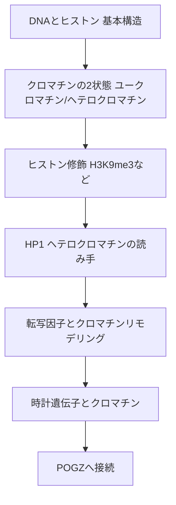
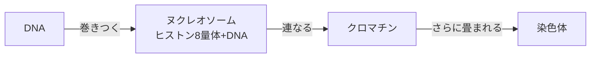
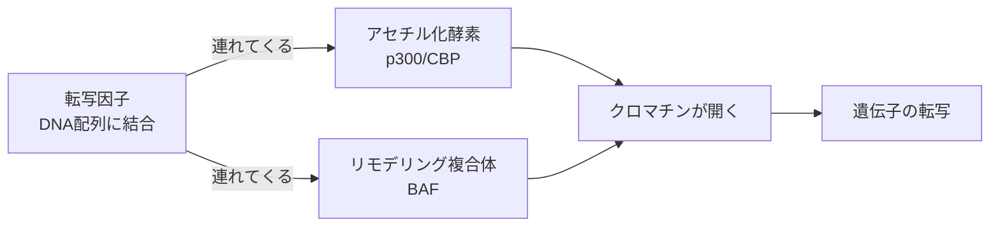

# 02. クロマチンとエピジェネティクスの基礎

> [!note] このノートについて
> [[00_概要|概日リズム学習の概要]]の2番目。[[01_概日リズムの基礎]]に続く。
> 最終目標「POGZの概日リズムにおける機能解析」を理解するための前提知識として、
> クロマチン構造とエピジェネティック制御の基礎を固める。
> 2026-10-20 に「**遺伝子 / タンパク質 / DNA配列のどれの話か**」が分かる粒度へ刷新した。

## 🗺️ 学習マップ

> [!question] このノートの出発点
> [[01_概日リズムの基礎#7. 光で時計を合わせる仕組み|01 §7]] で「CREB タンパク質が *Per* 遺伝子を ON にする」と書いた。
> でも DNA はヒストンに巻きついて畳まれている。**閉じている場所は、転写因子が来ても読めない**。
> では、遺伝子の「読める/読めない」は何で決まるのか？

---

## 1. DNAとヒストンの基本構造

- DNA は **ヒストン8量体**(H2A・H2B・H3・H4 タンパク質が2個ずつ)に巻きつき、**ヌクレオソーム**を作る
- ヌクレオソームの連なりが **クロマチン**
- ヒストンタンパク質の N 末端の尾(**ヒストンテール**)がヌクレオソームの外に突き出していて、化学修飾の足場になる
- クロマチンの畳まれ方によって、同じ DNA 配列でも「読まれるか/読まれないか」が変わる —— これが **エピジェネティクス** の核心(DNA 配列そのものは変えずに、遺伝子の使われ方を変える仕組み)

---

## 2. クロマチンの2状態:ユークロマチンとヘテロクロマチン

| 状態 | 畳まれ方 | 転写 | 代表的な場所 |
|---|---|---|---|
| **ユークロマチン** | ゆるい | 起こりやすい | 活発に使われる遺伝子の領域 |
| **ヘテロクロマチン** | 固い | 起こりにくい | セントロメア・テロメア・使われない遺伝子の領域 |

> [!tip] 核心
> 遺伝子の ON/OFF は、DNA 配列そのものではなく、**その場所のクロマチンがどちらの状態にあるか**で決まる場合が多い。
> これが、POGZ のような「クロマチンを制御するタンパク質」の遺伝子が壊れると病気になる理由。

> [!tip] 回路でいえば
> 転写因子 = 制御信号、クロマチン = スイッチ。スイッチが閉じたままだと、制御信号が来ても電流は流れない。

---

## 3. ヒストン修飾というコード

- ヒストンテールへの **メチル化・アセチル化・リン酸化** などの化学修飾が、クロマチンの状態を切り替える(「ヒストンコード」)
- 修飾は「どのヒストンの、何番目のアミノ酸に、何がついたか」で書く

| 修飾 | 読み方 | 意味 | 状態 |
|---|---|---|---|
| **H3K9me3** | ヒストンH3 の 9番目のリジン(K)に、メチル基が3つ | ヘテロクロマチンの目印 | 抑制 |
| **H3K27ac** | ヒストンH3 の 27番目のリジンがアセチル化 | 活発なエンハンサー/プロモーターの目印 | 活性化 |
| **H3K4me3** | ヒストンH3 の 4番目のリジンにメチル基が3つ | 活発な転写開始点の目印 | 活性化 |

### 3.1 修飾を扱う3種類のタンパク質

| 役割 | 何をするか | 例(タンパク質) |
|---|---|---|
| **Writer**(書き込む) | 修飾をつける酵素 | SUV39H1(H3K9 をメチル化)、p300/CBP(ヒストンをアセチル化) |
| **Eraser**(消す) | 修飾を外す酵素 | HDAC(脱アセチル化酵素) |
| **Reader**(読む) | 修飾を認識して結合する | HP1(H3K9me3 を読む) |

> [!note] 伏線:CBP = CREB-binding protein
> p300/CBP の「CBP」は、もともと **CREB タンパク質に結合するタンパク質**として見つかった名前。
> CREB タンパク質は、ヒストンをアセチル化する CBP を連れてきてクロマチンを開き、転写を促進する。
> → 「転写因子が、クロマチンを開く装置を連れてくる」という形は、[[03_POGZの分子機構|POGZ]] でもう一度出てくる。

---

## 4. HP1:ヘテロクロマチンの読み手

- **HP1(Heterochromatin Protein 1)** タンパク質は、H3K9me3 に直接結合する Reader
- ヒトには3種類ある

| タンパク質 | 遺伝子 |
|---|---|
| HP1α | *CBX5* |
| HP1β | *CBX1* |
| HP1γ | *CBX3* |

- HP1 タンパク質の2つの部品
  - **クロモドメイン**:H3K9me3 を認識して結合する
  - **クロモシャドウドメイン**:HP1 同士でペアを作ったり、他のタンパク質と結合したりする(多くの相手は **PxVxL** という短いアミノ酸配列で結合する)
- HP1 タンパク質は H3K9 をメチル化する酵素(SUV39H1 など)も呼び寄せる → 隣のヒストンにも H3K9me3 がつく → また HP1 が結合する … とヘテロクロマチンが**広がる**(正のフィードバック)

> [!important] POGZとの接点
> POGZ タンパク質は HP1 タンパク質(HP1α・HP1γ)に結合する。
> ただし結合の仕方は PxVxL 型ではなく、**ジンクフィンガーに似た領域**を使う、変わった方式([[03_POGZの分子機構#3. HP1との結合:変わった結合様式|03 §3]])。
> POGZ タンパク質自身が H3K9me3 を読むわけではなく、**Reader である HP1 タンパク質と組む**、という位置づけ。

---

## 5. 転写因子とクロマチンリモデリング

- **転写因子**:DNA の特定の配列(**モチーフ**)に結合し、近くの遺伝子の転写を促進または抑制するタンパク質
  - 例:CLOCK・BMAL1 タンパク質は **E-box**(DNA 配列 CACGTG)に、CREB タンパク質は **CRE**(DNA 配列)に、DBP タンパク質は **D-box**(DNA 配列)に結合する
- **クロマチンリモデリング複合体**:ATP のエネルギーでヌクレオソームの位置をずらし、DNA を露出させる複数タンパク質の集まり
  - 例:**BAF(SWI/SNF)複合体**。中心で ATP を使う部品は BRG1 タンパク質
  - 胚性幹細胞(ES細胞)で働く型を **esBAF** と呼ぶ
- DNA への転写因子の届きやすさ = **クロマチンアクセシビリティ**

---

## 6. 時計遺伝子とクロマチン

[[01_概日リズムの基礎#3. 分子時計:転写-翻訳フィードバックループ|01 §3]] のループは、クロマチンの開閉と一緒に回っている。

- 時計遺伝子(*Per1* など)のプロモーターでは、ヒストンのアセチル化が**1日周期で上下**し、転写の上下と一致する(Etchegaray et al., 2003)
- CLOCK タンパク質自身が**ヒストンアセチル化酵素(HAT)の活性**を持つ(Doi et al., 2006)
  → CLOCK・BMAL1 タンパク質は「E-box に結合する転写因子」であると同時に「その場のクロマチンを開く Writer」でもある
- PER・CRY タンパク質がブレーキをかけるときは、脱アセチル化酵素(HDAC)などを含む抑制複合体を連れてきて、クロマチンを閉じる方向に働く

> [!question] 思考メモ
> 時計遺伝子の転写が毎日 ON/OFF するなら、その場のクロマチンも**毎日開いたり閉じたり**しているはず。
> だとすると、「状況によって開ける側にも閉じる側にも働く」クロマチン制御タンパク質は、時計と相性がよさそう…？
> → [[03_POGZの分子機構]] で POGZ の二面性を見て、[[00_概要|04]] で検証する。

---

## 7. POGZへの接続:なぜクロマチン制御因子が「遺伝子」として語られるのか

- *POGZ* 遺伝子から作られる POGZ タンパク質は、複数の部品を持つ
  - DNA に結合する部品:ジンクフィンガー群、CENPB-DB
  - 他のタンパク質に結合する部品:HP1 結合領域
  - トランスポゾン由来の DDE ドメイン
- 「*POGZ* 遺伝子の機能解析」とは、実際には「**POGZ タンパク質が、ゲノムのどの場所のクロマチン状態を、どう制御しているか**」を明らかにすること
- 研究では *Pogz* 遺伝子を壊したマウス(POGZ タンパク質ができない)を作り、何が変わるかを見る
- 次のノートでは、POGZ タンパク質が **HP1 経由(閉じる側)** と **BAF 経由(開く側)** の**両方**に関わる二面性を掘り下げる

---

## 🔑 現時点でのまとめ

> **遺伝子が読めるかどうかは、その場のクロマチンの開閉で決まり、開閉はヒストン修飾というコードで切り替わる。**
> 修飾は Writer がつけ、Eraser が外し、HP1 のような Reader が読んで、閉じた状態を広げる。
> 転写因子は DNA 配列に結合し、アセチル化酵素やリモデリング複合体を**連れてきて**クロマチンを開く。
> 時計遺伝子もこの仕組みの上で毎日開閉している。POGZ タンパク質は、HP1 側と BAF 側の**両方に足をかける**特異なタンパク質。

---

## 📖 参考文献

> [!todo] 裏取り待ち
> 以下2本の書誌情報は、まだ SciSpace で確認できていない(2026-10-20 時点)。

- Etchegaray JP et al. (2003) Rhythmic histone acetylation underlies transcription in the mammalian circadian clock. *Nature* 421:177–182.
- Doi M, Hirayama J, Sassone-Corsi P (2006) Circadian regulator CLOCK is a histone acetyltransferase. *Cell* 125:497–508.

---

[[01_概日リズムの基礎|← 01へ]] ｜ [[00_概要|概要に戻る]] ｜ [[03_POGZの分子機構|03へ →]]
