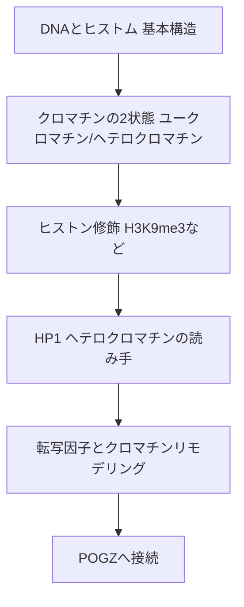

# 02. クロマチンとエピジェネティクスの基礎

> [!note] このノートについて
> [[00_概要|概日リズム学習の概要]]の2番目。[[01_概日リズムの基礎]]に続く。
> 最終目標「POGZの概日リズムにおける機能解析」を理解するための前提知識として、
> クロマチン構造とエピジェネティック制御の基礎を固める。

## 🗺️ 学習マップ

---

## 1. DNAとヒストンの基本構造

- DNAは**ヒストン8量体**(H2A・H2B・H3・H4が2個ずつ)に巻きつき**ヌクレオソーム**を形成
- ヌクレオソームの連なりが**クロマチン**。ヒストンのN末端尾部(テール)が核外に突き出し、化学修飾の足場になる
- クロマチンの凝縮度によって同じDNA配列でも「読まれるか/読まれないか」が変わる —— これが**エピジェネティクス**の核心

---

## 2. クロマチンの2状態：ユークロマチンとヘテロクロマチン

| 状態 | 凝縮度 | 転写活性 | 代表的な場所 |
|---|---|---|---|
| **ユークロマチン** | 疎 | 活発(転写可能) | 活発に発現する遺伝子領域 |
| **ヘテロクロマチン** | 密 | 抑制(転写不可) | セントロメア・テロメア・不要な遺伝子領域 |

> [!tip] 核心
> 遺伝子の「ON/OFF」はDNA配列そのものではなく、**クロマチンがどちらの状態にあるか**で決まる場合が多い。
> これがPOGZのような「クロマチン制御因子」が病気の原因になる理由。

---

## 3. ヒストン修飾というコード

- ヒストンテールへの**メチル化・アセチル化・リン酸化**などの化学修飾が、クロマチン状態を切り替える「ヒストンコード」
- 代表的な修飾と意味：

| 修飾 | 意味 | 状態 |
|---|---|---|
| **H3K9me3**(3番目のリジンのトリメチル化) | ヘテロクロマチンの目印 | 抑制 |
| **H3K27ac**(27番目のリジンのアセチル化) | 活発なエンハンサー/プロモーターの目印 | 活性化 |
| **H3K4me3** | 活発な転写開始点の目印 | 活性化 |

- 「Writer(書き込む酵素)」「Eraser(消す酵素)」「**Reader(読み取るタンパク質)**」の3者がセットで機能する
- POGZは**H3K9me3のReader**として位置づけられる(後述)

---

## 4. HP1：ヘテロクロマチンの読み手

- **HP1(Heterochromatin Protein 1)** は H3K9me3を直接認識して結合する「Readerタンパク質」
- ヒトには **HP1α・HP1β・HP1γ**(遺伝子名はCBX5・CBX1・CBX3)の3アイソフォームが存在
- HP1は**クロモドメイン**でH3K9me3を認識し、**クロモシャドウドメイン**で他タンパク質と二量体化・相互作用する
- HP1が結合した領域はさらに凝縮が進み、ヘテロクロマチンが「広がる」(ポジティブフィードバック)

> [!important] POGZとの接点
> POGZは**HP1結合モチーフ**を持ち、HP1(特にHP1γ)と直接結合する。
> これによりPOGZは「ヘテロクロマチンの状態を読み取り、クロマチン制御に関与する」足場となる。

---

## 5. 転写因子とクロマチンリモデリング

- **転写因子**：特定のDNA配列(モチーフ)に結合し、転写を促進/抑制するタンパク質
- **クロマチンリモデリング複合体**(例: BAF/SWI-SNF複合体)はATPを使ってヌクレオソームの位置を動かし、DNAへのアクセスしやすさ(**クロマチンアクセシビリティ**)を変える
- POGZは**esBAF複合体**(胚性幹細胞型BAF)と結合することが知られ、クロマチンリモデリングとヘテロクロマチン制御の両方に関わる、やや特殊な転写因子

---

## 6. POGZへの接続：なぜクロマチン制御因子が「遺伝子」として語られるのか

- POGZ自体はDNA結合ドメイン(ジンクフィンガー)・HP1結合モチーフ・CENPB-DBドメイン・DDEドメイン(トランスポゼース由来)を持つマルチドメインタンパク質
- 「POGZ遺伝子」の機能解析とは、実質的に「**POGZタンパク質がどの遺伝子領域のクロマチン状態を、どう制御しているか**」を明らかにすること
- 次のノートでは、POGZがヘテロクロマチン型(HP1経由の抑制)とユークロマチン型(BAF経由の活性化)の**二面性**を持つことを掘り下げる

---

## 🔑 現時点でのまとめ

> **クロマチンの開閉状態(ユークロマチン⇄ヘテロクロマチン)がヒストン修飾というコードで決まり、
> HP1のようなReaderタンパク質がそれを読み取って凝縮を広げる。**
> POGZはこのHP1読み取り経路とBAFリモデリング経路の**両方に足をかける**特異な因子。

---

[[00_概要|← 概要に戻る]]
