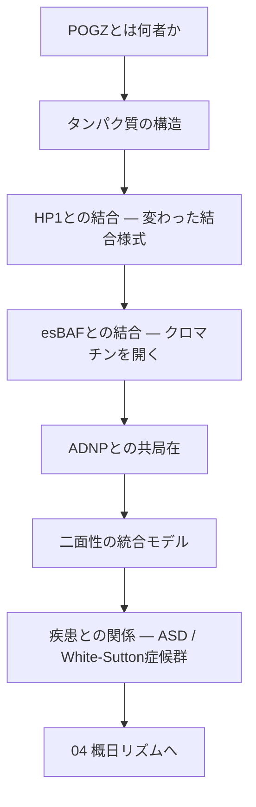
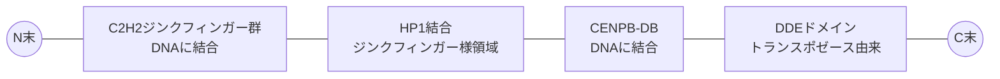
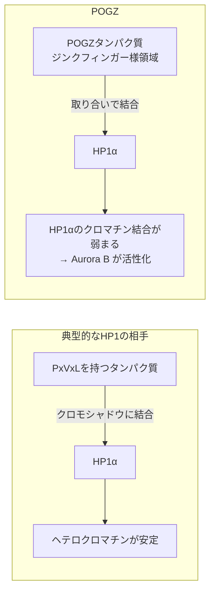
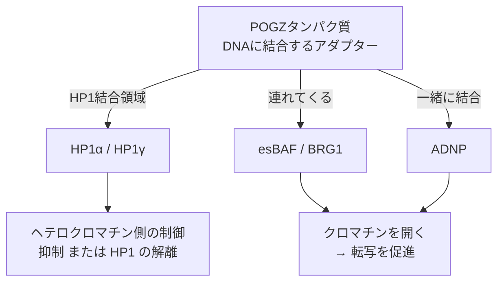
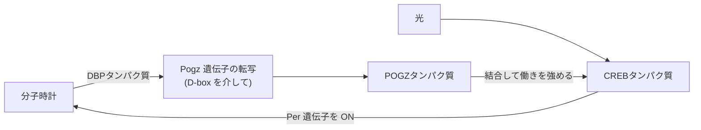

# 03. POGZの分子機構

> [!note] このノートについて
> [[00_概要|概日リズム学習の概要]]の3番目。[[02_クロマチンとエピジェネティクスの基礎]]に続く。
> 02 で「POGZ タンパク質は HP1 側と BAF 側の両方に足をかける」と書いた。ここではその中身を開ける。
> 問いはひとつ:**POGZ タンパク質は遺伝子を「閉じる」側なのか、「開ける」側なのか？**

## 🗺️ 学習マップ

> [!info] 表記
> ヒトの遺伝子は ***POGZ***、マウスの遺伝子は ***Pogz***(どちらも斜体)。タンパク質はどちらも **POGZ**(立体)。
> 詳しくは [[01_概日リズムの基礎#0. 用語の約束:遺伝子・mRNA・タンパク質|01 §0]]。

---

## 1. POGZとは何者か

- 正式名称 **POGO transposable element derived with ZNF domain**
- 名前の通り、*POGZ* 遺伝子から作られる POGZ タンパク質は「**トランスポゾン(pogo 型)由来の部品**」と「**ジンクフィンガー(ZNF)**」を併せ持つ。核の中で働く
- *POGZ* 遺伝子はヒト1番染色体(1q21.3)にある。全身で広く使われるが、特に**脳の発生**で重要

> [!question] 最初の違和感
> 「トランスポゾン由来」というのが面白い。
> 昔ゲノムに入り込んだ“動く遺伝子”の部品が、進化の過程で**宿主のクロマチン制御に転用(domestication)**された、という来歴を持つ。
> 似た来歴の例に CENP-B タンパク質(セントロメアに結合する)がある。POGZ タンパク質が CENP-B 型の DNA 結合部品を持つのはその名残。

---

## 2. タンパク質の構造

| 部品(ドメイン) | 役割(推定を含む) | メモ |
|---|---|---|
| **C2H2 ジンクフィンガー群** | DNA 配列に結合する | 転写因子としての「住所」を決める部分 |
| **HP1 結合ジンクフィンガー様領域** | HP1α・HP1γ タンパク質に結合する | 普通の HP1 の相手とは違う結合方式(→§3) |
| **CENPB-DB** | DNA に結合する | pogo/CENP-B 系トランスポゾンの名残 |
| **DDE ドメイン** | トランスポゼース(DNA を切り貼りする酵素)の触媒部分に似ている | 切り貼りの活性は失われていると考えられる。他のタンパク質と結合する足場？ |

> [!tip] 読み方
> 「DNA を掴む手(ジンクフィンガー・CENPB-DB)」と「他のクロマチン制御タンパク質を掴む手(HP1 結合領域など)」を同時に持つ。
> → **ゲノムの特定の場所に、特定のクロマチン装置を連れてくるアダプター**として理解するとわかりやすい。

---

## 3. HP1との結合:変わった結合様式

- [[02_クロマチンとエピジェネティクスの基礎#4. HP1:ヘテロクロマチンの読み手|02 §4]] の通り、HP1 タンパク質はクロモシャドウドメインで相手と結合する
- 多くの相手のタンパク質は **PxVxL** という短いアミノ酸配列で結合する
- ところが POGZ タンパク質は、**ジンクフィンガーに似た領域**で HP1α タンパク質に結合する(Nozawa et al., 2010)

> [!important] ここがキモ:POGZ タンパク質は「HP1 を外す」側にも働く
> Nozawa らの報告では、
> - POGZ タンパク質の HP1α への結合は、**PxVxL 型のタンパク質と取り合いになり**、HP1α タンパク質のクロマチンへの結合を**弱める**
> - *POGZ* 遺伝子の働きを落とすと(ノックダウン)、細胞分裂のときに染色体から HP1α タンパク質が外れにくくなり、**Aurora B**(分裂を進めるリン酸化酵素)が十分に活性化されない → 分裂の異常が起こる
> - POGZ タンパク質の **HP1 結合領域だけ**を細胞に作らせると、この異常が元に戻る
>
> つまり POGZ タンパク質と HP1 タンパク質の結合は、「HP1 を連れてきてヘテロクロマチンを固める」だけではなく、
> **「HP1 の結合を緩める」** 方向にも働きうる。

> [!question] 思考メモ
> 02 を最初に書いたときは「POGZ = HP1 経由の抑制側」と単純化していた。
> でもこの結果を見ると、**HP1 と結合する ≠ 抑制する** と考えた方がよさそう。
> HP1 タンパク質は「抑制の目印」というより、**状況次第で役割が変わる足場**なのかもしれない。

---

## 4. esBAFとの結合:クロマチンを開く

- **esBAF**(ES細胞型の BAF 複合体。ATP を使う中心部品は BRG1 タンパク質)は、ヌクレオソームを動かしてクロマチンを開く複合体
- マウス ES 細胞では、**POGZ タンパク質・esBAF 複合体(BRG1)・HP1 タンパク質**が3者で複合体を作る
- POGZ タンパク質が制御する場所のクロマチンの開き具合は、**esBAF/BRG1 に依存**する(Molecular Autism, 2022 / bioRxiv 2021)
- *Pogz* 遺伝子を壊すと、ES 細胞の未分化性(何にでもなれる状態)を保てなくなる

---

## 5. ADNPとの共局在:脳の発生の文脈

- 胎児期のマウス前脳で、POGZ タンパク質がゲノムのどこに結合しているかを網羅的に調べると(ChIP-seq)、**ヘテロクロマチンではなくユークロマチン側**(エンハンサーなどの制御領域)に多い(Markenscoff-Papadimitriou et al., *Cell Reports* 2021)
- *Pogz* 遺伝子を壊したマウスでは、ゲノム上で**かたまって並んでいるシナプス関連遺伝子**のクロマチンが閉じ気味になり、転写も下がる → POGZ タンパク質は**転写を促進する側**として働いている
- 結合場所の多くで、**ADNP タンパク質**(*ADNP* も自閉スペクトラム症の高リスク遺伝子)と **HP1γ タンパク質** も一緒に結合している。POGZ タンパク質と ADNP タンパク質は核の中で複合体を作る

> [!warning] 注意
> POGZ–ADNP 複合体の生理的な意味は、まだ議論の余地がある段階と見ておく。
> ADNP タンパク質は、HP1 タンパク質・CHD4 タンパク質と「ChAHP」という別の複合体も作る。**HP1 を中心としたネットワーク**として見るのがよさそう。

---

## 6. 二面性の統合モデル

| 文脈 | POGZ タンパク質の相手 | クロマチンへの効果 | 転写 |
|---|---|---|---|
| 細胞分裂中の染色体 | HP1α(取り合いで結合) | HP1α を外す | — |
| ES 細胞 | esBAF(BRG1)+ HP1 | 開く | 促進 |
| 胎児期の前脳 | ADNP + HP1γ | 開く | 促進(シナプス関連遺伝子) |
| (古典的な見方) | HP1 | 閉じる | 抑制 |

> [!abstract] 現時点の自分の理解
> POGZ タンパク質は「抑制するタンパク質」でも「促進するタンパク質」でもなく、
> **HP1 タンパク質が乗っている(乗りうる)場所に入り込み、その場のクロマチンを“どちらにも動かせる”調節アダプター**。
> どちらに振れるかは、細胞の種類・時期・一緒にいる相手(BAF か、ADNP か)で決まる。

> [!question] 概日リズムにつなげるための問い
> 時計遺伝子の転写は1日の中で周期的に ON/OFF し、そのたびにクロマチンも開閉している([[02_クロマチンとエピジェネティクスの基礎#6. 時計遺伝子とクロマチン|02 §6]])。
> → 「状況によって開ける/閉じる」POGZ タンパク質は、**時刻によるクロマチンの切り替え**に関わる候補として相性がよさそう…？
> これを 04 で検証する。

---

## 7. 疾患との関係

- **自閉スペクトラム症(ASD)**:大規模なゲノム解析で、*POGZ* 遺伝子の *de novo* 変異(親にはなく子で新たに生じた変異)が繰り返し見つかる。高リスク遺伝子のひとつ
- **White-Sutton 症候群**:*POGZ* 遺伝子の機能が失われる変異による神経発達症(知的障害・発達の遅れ・小頭症・**睡眠障害**などを含む)
- マウスモデル
  - 患者で見つかった変異を *Pogz* 遺伝子に導入したマウスで、大脳皮質の発生異常と ASD 様の行動(Matsumura et al., *Nat Commun* 2020)
  - *Pogz* 遺伝子を壊したマウスで、小脳の転写異常と ASD 様の行動(Suliman-Lavie et al., *Nat Commun* 2020)

> [!important] 睡眠障害という伏線
> ASD・White-Sutton 症候群の両方で、**睡眠の問題**が多い。
> 「クロマチン制御タンパク質の異常 → 発達障害」という話と「概日リズム」が、ここでつながる。

---

## 8. 04への橋:POGZと体内時計(予告)

He et al. (2026, *JCI Insight*) の要旨から、04 で深掘りする論点だけ先に置いておく。

| | 内容 |
|---|---|
| 示されたこと | DBP タンパク質が *Pogz* 遺伝子の **D-box**(DNA配列)に結合して転写を促進し、*Pogz* の mRNA が1日周期で上下する |
| 示されたこと | POGZ タンパク質は CREB タンパク質に結合し、その働きを強める |
| 示されたこと | *Pogz* 遺伝子を壊したマウスで、自走周期が長くなり、光による位相のずれが小さくなる |
| 仮説 | POGZ タンパク質が esBAF などを連れてきて、*Per* 遺伝子周辺のクロマチンを開いているのでは(本ノート §4 からの推測) |
| 要確認 | SCN で POGZ **タンパク質**の量がいつ最大になるか。光が効く夜と重なるか |

---

## 🔑 現時点でのまとめ

> ***POGZ* 遺伝子から作られる POGZ タンパク質は、DNA に結合し、HP1・esBAF・ADNP といったクロマチン装置をその場に連れてくるアダプター。**
> HP1 タンパク質と結合するが単純な抑制役ではなく、BAF を介してクロマチンを開き、神経関連遺伝子の転写を促進する顔も持つ。
> この「開閉を切り替える力」が、時計遺伝子の周期的な転写とどう関わるのか —— が次の問い。

---

## 📖 参考文献

- Nozawa RS et al. (2010) Human POGZ modulates dissociation of HP1α from mitotic chromosome arms through Aurora B activation. *Nat Cell Biol* 12:719–727. [PubMed](https://pubmed.ncbi.nlm.nih.gov/20562864)
- Markenscoff-Papadimitriou E et al. (2021) Autism risk gene POGZ promotes chromatin accessibility and expression of clustered synaptic genes. *Cell Reports*. [PMC](https://www.ncbi.nlm.nih.gov/pmc/articles/PMC9512081/)
- Autism-associated protein POGZ maintains embryonic stem cells by association with esBAF and HP1γ. [bioRxiv](https://www.biorxiv.org/content/10.1101/2021.02.07.430173v1)
- Matsumura K et al. (2020) Pathogenic POGZ mutation causes impaired cortical development and reversible autism-like phenotypes. *Nat Commun*.
- Suliman-Lavie R et al. (2020) Pogz deficiency leads to transcription dysregulation and impaired cerebellar activity underlying autism-like behavior in mice. *Nat Commun*.
- He J et al. (2026) Reciprocal regulation between autism risk gene POGZ and circadian clock. *JCI Insight*. [DOI](https://doi.org/10.1172/jci.insight.193622)
- OMIM \*614787 POGZ

---

[[02_クロマチンとエピジェネティクスの基礎|← 02へ]] ｜ [[00_概要|概要に戻る]] ｜ 04 POGZ×概日リズムの研究知見(未作成) →
