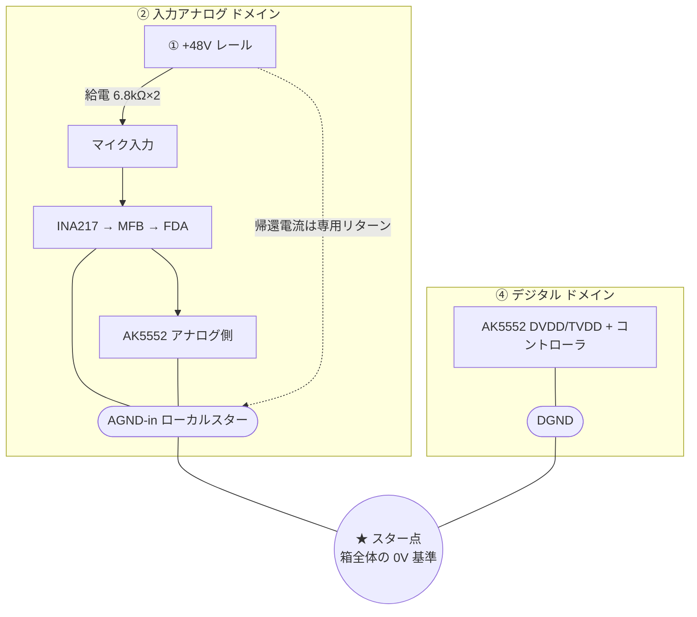

[[オーディオIF_概要|自作オーディオI/F]] の土台になる考え方。電源とGNDをどう島に分け、どこでつなぐか。

## 電源ブロック分割

> [!note] ドメインの考え方
> 1ドメイン = { +V, -V, GNDリターン } の**三点セットが1組**。
> ドメイン内では +/- は共通GNDに戻す。ドメイン間はスター点1箇所だけで結合。

| # | ブロック | 中身 | 性格 |
|---|---------|------|------|
| ① | ファントム | +48V 単電源（専用巻線） | 高電圧・低変動・安全重視 |
| ② | 入力アナログ | ADC入力段, マイクプリ, ライン受け | 小信号・クリーン |
| ③-a | 出力アナログ | DAC, VREF | 小信号・最優先クリーン |
| ③-b | 出力ドライブ | HP / モニタ出力段 | 大電流・変動大 |
| ④ | デジタル | コントローラ, I/O | ノイズ源側 |
| ⑤ | クロック | OCXO専用 | 最優先で独立 |

※現時点で詰めているのは主に **①②** と、その電源部。

---

## GND戦略（スター1点結合）

> [!important] GNDの二役
> GND = 「電流の帰り道（リターン）」と「電圧の基準(0V)」の二役。
> 島の中では帰り道、島同士が触れるスター点では基準。

- ファントム(①)は「**レールは独立巻線 / GND基準は②に属する**」という非対称な位置づけ
- ファントム帰還電流は専用リターンで引き、②のローカルスターで合流（信号GNDと分ける）
- AK5552は②(アナログ)と④(デジタル)の**国境**。AVDD/AGND=②, DVDD/DGND=④

## 関連
- 信号の流れ → [[03_入力段|入力段]]
- 各ドメインの電源 → [[05_電源部|電源部]]
- ① のレール → [[06_ファントム電源|ファントム電源]]
