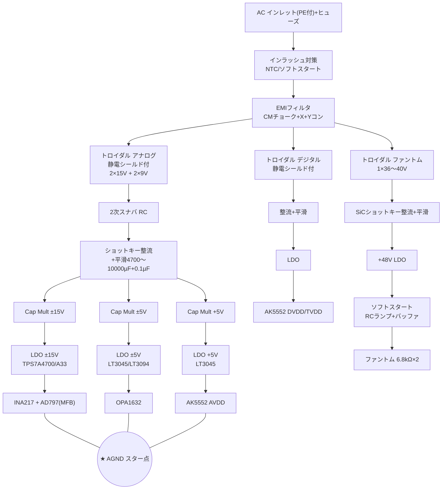

[[オーディオIF_概要|自作オーディオI/F]] の電源部。[[02_ドメイン分割とGND|ドメイン分割]] で分けた島ごとに、レールを用意する。

## 必要レール一覧

| レール | 供給先 | 由来 |
|---|---|---|
| ±15V | INA217 + MFB(AD797) | アナログ大巻線 2×15〜18V |
| ±5V | FDA(OPA1632) | 低圧巻線 2×7〜9V（±15Vからでなく低圧巻線で作り、発熱を削減） |
| +5V AVDD | AK5552 アナログ | ±5Vの+側生バス共有 or 専用巻線 ※要確認 |
| DVDD/TVDD | AK5552 デジタル | **別トランス（デジタル系）** |
| +48V | ファントム | 専用巻線（昇圧しない＝スイッチングノイズ回避） |

> [!note] ±5V の作り方（確定案）
> 約9V巻線を2つ独立に整流・平滑 → 直列にして中点=AGND で ±化。
> - +側：Cap Mult→LDO を **FDA用とADC AVDD用に別系統**で分離（レール=LDO後は共有しない）
> - -側：Cap Mult→LDO で FDAのみ
> - 独立整流なので +/- 非対称負荷でも問題なし（+側を余裕もってサイジング）

## 部品選定

| 部位 | 推奨 | メモ |
|---|---|---|
| トランス | トロイダル・**静電シールド付**（Plitron等※） | 1次-2次結合ノイズを断つ最重要点。シールドはPEへ |
| AC入口 | メディカルEMIフィルタ（Schaffner等※）+ X/Yコン | 安全規格認証品必須 |
| インラッシュ | NTC or リレー式ソフトスタート | トロイダルは突入大 |
| 2次スナバ | R=10〜100Ω + C=10〜100nF（各巻線並列） | 整流リンギングのダンプ |
| 整流Di | **ショットキー**（±5/±15V）, SiC/ソフトリカバリ(+48V) | 逆回復ノイズを断つ |
| 平滑Co | 4700〜10000µF + 0.1µFフィルム並列 | 大きすぎ注意（突入増）|
| Cap Mult | Nch/Pch MOSFET + Rg(1〜10k)・Cg(100〜470µF) | 各レール独立, 放熱はビア+筐体 |
| LDO ±15V | **TPS7A4700 / TPS7A33**（TI）※ | 高耐圧・超低ノイズ |
| LDO ±5V/AVDD | **LT3045 / LT3094**（ADI）※ | 出力ノイズ約1µVrms※。AVDDは最静音を |

> [!tip] リプル計算
> `Vripple(pp) ≈ I_load / (2 · f_line · C)`
> 例: I=100mA, f=50Hz, C=4700µF → 約0.21Vpp（後段Cap Mult+LDOが叩く前提でOK）

---

## AC入力〜電源部 全体図

## 関連
- [[02_ドメイン分割とGND|ドメイン分割とGND]]
- [[06_ファントム電源|ファントム電源]]
- 電源方式を決めたときのメモ → [[01_基本仕様|基本仕様]]
