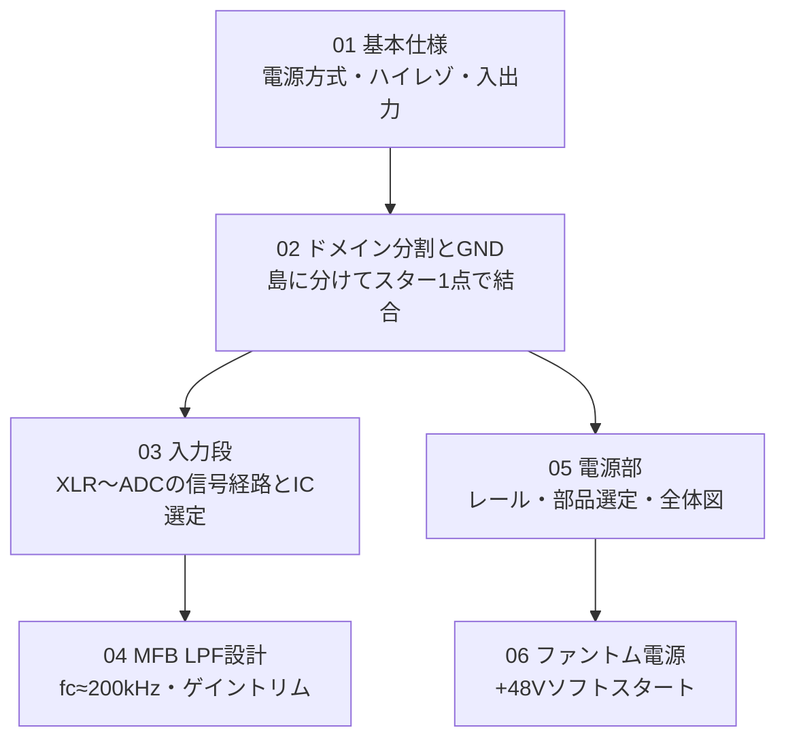

# 自作オーディオI/F

> [!info] このページについて
> 自作オーディオI/Fの入口。全体の考え方、確定事項、残タスクをここに集め、設計の中身は各ノートに分けている。
> ※部品の数値・型番で「※要確認」が付くものは、データシートでの最終確認が必要。

---

## 全体コンセプト

- **用途**: 会話・歌がメイン（ボーカル録音中心）
- **入力**: 2系統
  - ① マイク入力（コンデンサ／ダイナミック両対応, XLR, ファントム給電）
  - ② ライン入力（外部音源, 例: PCのオーディオ出力）
- **設計思想**:
  - 超低ノイズ・完全バランス（差動）を最後まで貫く
  - 電源・GNDを**ドメイン（島）で分離**し、最後に**スター1点**で結合
  - アナログ電源は全て「**整流 → 平滑 → Cap Multiplier(MOSアクティブフィルタ) → LDO**」で統一
  - スイッチング電源・昇圧は極力避け、ハードで対称に作る

## ノートのつながり

## ノート一覧

| 番号 | ノート | 内容 |
|---|---|---|
| 01 | [[01_基本仕様\|基本仕様]] | 電源方式、ハイレゾ対応、入出力の検討メモ |
| 02 | [[02_ドメイン分割とGND\|ドメイン分割とGND]] | 電源ブロックの分け方とスター1点結合 |
| 03 | [[03_入力段\|入力段]] | マイク入力の信号経路、定数の根拠、ゲイン配分、IC選定 |
| 04 | [[04_MFB-LPF設計\|MFB LPF設計]] | ΔΣ ADC 前段のLPFとゲイントリム |
| 05 | [[05_電源部\|電源部]] | 必要レール、部品選定、AC入力からの全体図 |
| 06 | [[06_ファントム電源\|ファントム電源]] | +48Vのソフトスタートとマイク保護 |

## 未着手の区画（今後追加予定）

- 出力段（③ DAC / HP・モニタ）
- クロック（⑤ OCXO）
- ライン入力（入力の2系統目）

---

## 確定事項サマリ（早見）

| 項目 | 確定値 |
|---|---|
| 用途 | 会話・歌メイン |
| ハイパス fc | 3Hz |
| DCカット | 無極性AL 22µF + フィルム0.1µF（63V以上） |
| バイアス抵抗 | 2.2kΩ×2（対称ペア） |
| マイクプリ | INA217（+30dB固定, RG=324Ω） |
| LPF | MFB, AD797, fc=200kHz, R1ポットでトリム |
| FDA | OPA1632（+6dB, VOCM=VCM） |
| ADC | AK5552（差動, 24bit/192kHz超） |
| ±15V LDO | TPS7A4700 / TPS7A33 |
| ±5V/AVDD LDO | LT3045 / LT3094 |
| 整流 | ショットキー（+48VはSiC/ソフト） |
| トランス | トロイダル・静電シールド付 |
| ファントム | +48V専用巻線 + ソフトスタート |

## 残タスク

### 入力段
- [ ] INA217固定ゲインの最終確認（大声寄せ+26dB / ささやき寄せ+34dB の調整余地）
- [ ] ライン入力(②系統目)の受け方の設計
- [ ] ゲイン範囲の見直し：[[03_入力段|入力段]]は MFB ±15dB（実効 +15〜+45dB）だが、[[04_MFB-LPF設計|MFB LPF設計]]の定数では 0〜+12.7dB（INA217 と合わせて +30〜+42.7dB）。必要な +19dB まで下げられない
- [ ] MFB のQ変動の見直し：R1 を下げるとQが下がる。R1=390Ω で Q≈0.34、96kHz で約-4.2dB、20kHz で約-0.3dB（計算値。-0.23dB が成り立つのは R1=1690Ω のときだけ）

### 電源部
- [ ] Cap Multの定数確定（Rg・Cg・MOSFET品番・放熱・各レール実降下）
- [ ] ±5V/AVDD巻線電圧を LT3045ドロップアウトから逆算（+5V用は6.3〜8V RMS必要）
- [ ] ファントム+48Vの整流・LDO・ソフトスタート回路の定数
- [ ] トロイダルの具体品番・VA・静電シールド仕様の確定（Plitron等）
- [ ] EMIフィルタの具体品番（Schaffner等）

### その他
- [ ] 出力側（③DAC / HP・モニタ）の設計（未着手）
- [ ] クロック（⑤OCXO）の設計（未着手）
- [ ] 各種型番「※要確認」のデータシート突き合わせ
