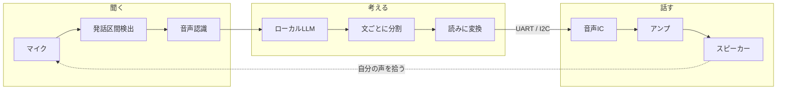
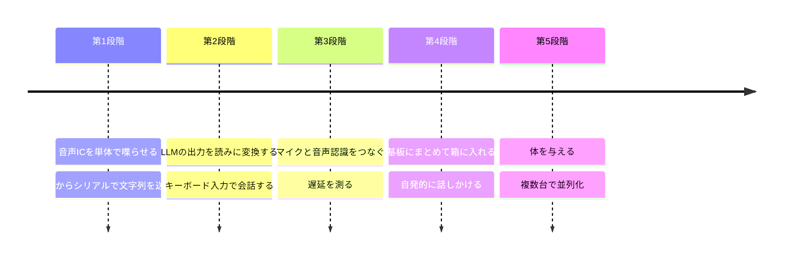

ローカルLLMと、音声ICを組み合わせて、機械音声で会話できるロボットというか、システムというか、タチコマみたいなものを作りたい。

> [!warning] このノートについて
> 冒頭の一文が出発点。論点の洗い出しと概算は AI（Claude）との対話で整理したもので、まだ何も決まっていない。
> 数値は目安で、※要確認 が付くものはデータシートや実機での確認が必要。

---

## 何があると「タチコマっぽい」のか

人間に似せた滑らかな声が欲しいわけではない。**機械だと分かる声で、でも中身がよく喋る**というギャップが欲しい。

- 声は機械のまま。音声ICのカクカクした発音は欠点ではなく、キャラクター
- 聞かれたことに答えるだけでなく、自分から話しかけてくる
- 物理的な体がある。スピーカーではなく「そこにいる何か」
- 複数台で記憶を共有する（並列化）。ロマン枠だが、LLMの会話ログを同期するだけなら意外と素直にできそう

> [!question] 「ロボット」か「システム」か
> 机の上に置く喋る箱で満足するのか、動き回ってほしいのか。
> 後者なら計算機を載せるか外に置くか、電源はどうするかが一気に重くなる。

## 全体の信号の流れ

最後の点線が地味に厄介。放っておくと、自分の声に自分で返事をする機械になる。

## 音声ICの何が嬉しいのか

ソフトウェアの音声合成でも喋れる。それでもICを使うのは、**声が部品になる**から。

- 文字列をシリアルで投げれば喋る。計算機の負荷がほぼゼロで、LLM と CPU を取り合わない
- 計算機が落ちていても、マイコンだけで定型文を喋れる（起動中です、電池がありません、など）
- 声の質がハードで固定される。この個体の声、という感じが出る

第一候補は AquesTalk pico LSI（ATP3011系）。声違いの品種があり、ATP3011F4-PU は「かわいい女性の音声」として売られている。接続は I2C / UART / SPI を選べる。28ピンDIPで、ブレッドボードから始められる。※要確認（データシート本文は未読）

### 漢字をどう読ませるか

ここが構想の中で一番の未解決問題。LLM の出力は漢字かな混じりだが、音声ICに渡せるのは読みの記号列だけ（ローマ字ベースのはず ※要確認）。

| 方式 | 中身 | 良い点 | 懸念 |
| :--- | :--- | :--- | :--- |
| A. 形態素解析 | LLM の出力を MeCab 等で読みに変換 | 決定論的で速い | アクセントまでは別途考える必要あり |
| B. LLM に書かせる | システムプロンプトで「ひらがなだけで話せ」と指示 | 変換器が要らない | 小さいモデルだと守らない、読みを間違える |
| C. 変換も LLM | 別の小さなモデルで読みを付ける | 文脈を見て読める | 遅延が増える、計算資源を食う |

まず A で作るのが堅そう。記号列として不正な文字を送るとICがエラーを返すはずなので、送信前の検査も要る。※要確認

## 遅延の予算

会話として成立するかは、ほぼこれで決まる。話し終えてから声が出るまでの時間は、

$$
T = T_\text{無音判定} + T_\text{音声認識} + T_\text{LLM初回} + \frac{N_\text{最初の一文}}{R_\text{生成}} + T_\text{音声IC}
$$

全文の生成を待たず、**最初の一文ができた時点で喋り始める**のが肝。回路でいうと、全部バッファしてから出すのではなく、レイテンシだけ決めてストリーミングする感じ。

最初の一文を 20 トークン、生成速度を 5 tok/s とすると、この項だけで 4 秒。無音判定で 0.5 秒、音声認識で 1 秒と置くと、合計 5.5 秒以上。長い。

Raspberry Pi 5（8GB）で全部動かした事例は、端から端まで 8〜25 秒という報告がある。生成速度の報告は 2〜22 tok/s と、モデルの大きさや構成でかなり幅がある。どれも英語の話で、日本語の数字は見つけられていない。※要確認

> [!tip] 待ち時間も演出にする
> 聞き取れた瞬間に「ピッ」と鳴らす、「えーと」と定型文を喋る、首をかしげる。
> 音声ICは負荷が軽いので、LLM が考えている間も喋れる。ここはICの強みになりそう。

## 頭をどこに置くか

| 構成 | 中身 | 応答 | 動ける？ | 所感 |
| :--- | :--- | ---: | :---: | :--- |
| A. 外部PC＋薄い体 | GPU の PC で推論、体はマイコンと無線 | ◎ | ○ | 一番賢くできる。家の中限定 |
| B. Pi 5 に全部 | 体の中で完結 | △ | ◎ | 一番それっぽい。遅さとの戦い |
| C. 小型GPU機を搭載 | Jetson など | ○ | △ | 電力と熱が重い。※要確認 |

A で育てて、モデルが小さく賢くなったら B へ移す、という順番が現実的か。体側を「マイク・音声IC・モーターを叩くマイコン」として切り出しておけば、頭だけ後から差し替えられる。

## ハード屋として気になること

- **自分の声の回り込み**：最初は喋っている間マイクを無視する半二重で十分。話を遮れるようにするならエコーキャンセルが要る。その場合、音声ICの出力をADCで参照として取り込む必要があるので、基板設計の時点で配線を引いておきたい
- **モーターのノイズ**：動く場合、駆動ノイズと機械音の両方がマイクに入る。電源の分離は[[オーディオIF作成|オーディオI/F]]で考えていることがそのまま効きそう
- **マイク**：ファンの近くに置かない。PDM の MEMS マイクか、アナログで[[オーディオIF作成～入力～|入力段]]を組むか
- **音声ICの出力**：直接スピーカーを鳴らす前提の品ではないはずなので、アンプとフィルタを挟む。※要確認

## 体の案

- 卓上の箱に、目の代わりのLEDだけ
- 首振りだけできる置物
- 四脚や[[球体多脚CanSat|球体多脚]]のように歩く。外装は[[3Dプリンター|自作3Dプリンター]]で出せたら最高

まずは喋る箱でよい。体は声ができてから考える。

## 進め方

## 考えたいこと

- [ ] 声はどれにするか。ICの品種を聴き比べる
- [ ] 読み変換を形態素解析で済ませられるか。誤読はどれくらい気になるか
- [ ] LLM のモデルと、何秒までなら会話として許せるか
- [ ] どんな性格にするか。システムプロンプトでどこまで作れるか
- [ ] 自発的に喋るきっかけ（時間、音、人の気配？）
- [ ] 会話の記憶をどう持つか。LLM の文脈長は限られる
- [ ] 常時マイクを開けるなら、起動ワードは要るか
- [ ] [[USB-シリアル変換・GPIO|USB-シリアル変換モジュール]]を、音声ICの制御に流用できるか

## 参考

- [AquesTalk pico LSI用Grove(M5)接続基板](https://www.switch-science.com/products/7625)（接続方式、電源、パッケージ）
- [M5Stack用 AquesTalk pico LSIモジュール基板](https://www.switch-science.com/products/7624)（I2C / UART / SPI の選択）
- [Raspberry Pi 5 Local Voice AI: What Works in 2026](https://dev.to/pat9000/raspberry-pi-5-local-voice-ai-what-works-in-2026-21ic)（Pi 5 での遅延の報告例）
- [Raspberry Pi 5 Local LLM Server: Best Models for 8GB RAM in 2026](https://specpicks.com/reviews/raspberry-pi-5-local-llm-server-best-models-8gb-2026)（生成速度の報告例）
