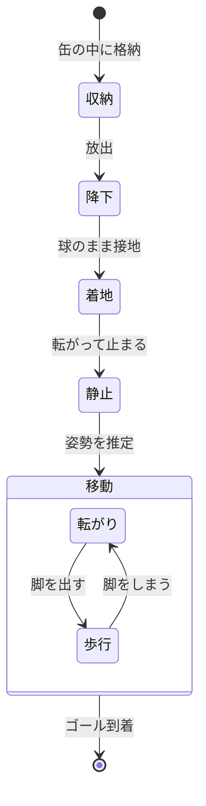

CanSatで、完全球体で、多脚の機体を作りたい。

閉じれば継ぎ目も見えない球。開くと、殻そのものが脚になる生き物。

> [!note] このページについて
> 構想だけをまとめたページ。AI（Claude）との対話で整理した内容を含む。
> 検討の過程や概算は [[球体多脚CanSat～検討ログ～|検討ログ]] に残している。

---

## どんな機体か

- 缶サイズ（φ66 mm）に収まる、**完全な球体**
- 殻は6枚のパネルに分かれていて、**パネルがそのまま脚**になる
- 脚は全方向に対称。**上下がなく**、どの向きで止まってもそのまま動ける
- 地形を見て、**歩く**か**転がる**かを自分で選ぶ
- 転がるときも、脚で地面を蹴って進む
- 着地点から、自分の力で**ゴールまで移動する**

## 動きのイメージ

## 移動法の使い分け

| 地形 | 移動法 |
| :--- | :--- |
| 硬い平地、下り坂 | 転がる |
| 急な上り坂、段差 | 歩く |
| ゴール直前 | 歩く |

## 決めたこと

| 項目 | 決定 |
| :--- | :--- |
| ミッション | ゴールまで移動する |
| 機体サイズ | φ66 mm の球 |
| 脚の収納 | 殻＝脚（6枚のパネル） |
| 脚の自由度 | 1枚につき2自由度（開閉＋旋回） |
| 移動法 | 歩行と転がりを地形で切り替え |
| 転がり方 | 脚で蹴る |

## まだ決めていないこと

- [ ] 狙う大会とクラス
- [ ] 小さなサーボで蹴れるか（パネル1枚を試作して確かめる）
- [ ] 部品が実寸で球に入るか
