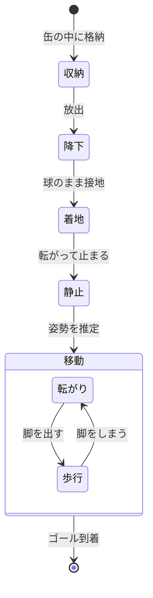
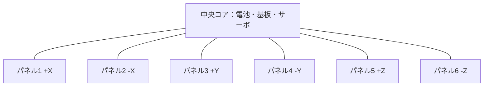
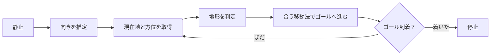
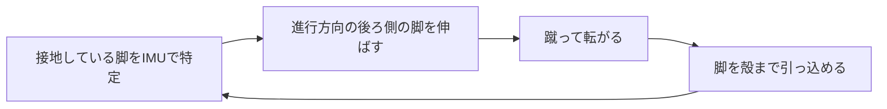

[[球体多脚CanSat|球体多脚CanSat構想]] の検討ログ。

CanSatで、完全球体で、多脚の機体を作りたい。

> [!warning] このノートについて
> 冒頭の一文が出発点。論点の洗い出しと概算は AI（Claude）との対話で整理したもの。決まったことは「→ 決定」と書いている。
> 数値は目安で、※要確認 が付くものは大会レギュレーションやデータシートでの確認が必要。

---

## 動きのイメージ

## 「球」と「多脚」は相性が悪い

- 球は殻に**隙間がないほど**きれい。脚は殻を**突き破らないと**出られない。
- 球は内側の形が丸いので、四角い部品（サーボ、基板、電池）を詰めるほど隙間が余る。
- 脚が増えるほどアクチュエータが増え、球の中がそれで埋まる。

でも、ここが一番面白いところ。**閉じれば継ぎ目も見えない球、開くと生き物**、というギャップを作りたい。

> [!question] 「完全球体」の線引き
> 閉じた状態で球ならOKか、継ぎ目（スリット）はどこまで許すか。
> ここを先に決めないと、機構の選択肢が絞れない。

## 上下がない、という設計

球はどの向きで止まるか分からない。逆に言えば、**脚を全方向に対称に配置すれば、上下の概念を捨てられる**。ひっくり返っても、そのまま歩ける機体になる。

代償として、常に上半分の脚は地面に届かず遊ぶ。正多面体の頂点に脚を置くとして、ざっくり比べるとこうなる。

| 配置 | 脚の本数 | サーボ数（1脚2自由度） | 所感 |
| :--- | ---: | ---: | :--- |
| 正四面体 | 4 | 8 | 接地3本、持ち上げると倒れる。歩くより転がる動きになりそう |
| 正八面体 | 6 | 12 | 横向きの4本で歩けそう。本命？ |
| 立方体 | 8 | 16 | 4本接地で安定、4本遊ぶ |
| 正二十面体 | 12 | 24 | ロマン枠。缶サイズでは絶望的 |

## 脚のしまい方

| 方式 | 中身 | 球のきれいさ | 懸念 |
| :--- | :--- | :---: | :--- |
| A. 殻＝脚 | 殻を花びら状に分割し、殻そのものを脚にする | ◎ | 曲面の板は脚として細く作りにくい |
| B. 殻がハッチ | 殻が開いて、中から脚が伸びる | ○ | 脚の収納スペースとハッチの駆動が別に要る |
| C. 表面に沿わせる | 球面の溝に脚を巻き付けて収納 | △ | 溝が見える。着地の衝撃を脚が直接受ける |

変形する球型の先例としては SORA-Q（LEV-2）がある。あちらは車輪のような走行で、多脚ではない。※要確認

### 採用：A. 殻＝脚

→ 決定。閉じれば球、開くと殻そのものが脚になる。

正八面体の6頂点に脚を置くなら、殻の分割は**立方体の6面を球に膨らませた形**になる（正八面体と立方体は双対）。頂点ひとつに、丸い四角のパネルが1枚。パネルの幅は、球の周の $1/4$ で約 52 mm。

殻が全部脚になるので、構造の考え方が変わる。

- **骨格は中央コア**。殻は構造を支えない。力はすべてヒンジを通ってコアに入る
- **着地衝撃**もヒンジに入る。閉じた状態のパネルは、ラッチで受ける？ サーボの保持力に頼るとギアが死ぬ
- **開いている間は中が丸見え**。砂が入るので、コア側は別に密閉したい
- **脚の形**は曲面の板。細い脚にはならないので、接地するのはパネルの角か縁
- **蹴る向きはヒンジの向きで決まる**。6枚のヒンジ配置をどう回すかが、転がれる方向を決める

殻の厚みも体積を食う。厚さ 2 mm なら内径 φ62 で、中身に使えるのは約 125 cm³。

### パネル1枚は2自由度

→ 決定。1枚につきサーボ2個、合計12個。

| 軸 | 動き | 歩行での役割 | 蹴りでの役割 |
| :--- | :--- | :--- | :--- |
| ① 開閉（ヒンジ） | パネルを開く | 脚を上げ下げする | 地面を押す |
| ② 旋回（頂点まわり） | 開いたパネルごと回す | 脚を前後に振る | 蹴る向きを変える |

②の旋回が付いたおかげで、蹴る向きをヒンジの向きに縛られなくなる。転がれる方向の制約がだいぶ緩むはず。

ただし、増えるものもある。

- **閉じる前に、旋回を正確にゼロへ戻す必要がある**。四角いパネルは回ったままだと球に戻れない。位置精度がそのまま継ぎ目の精度になる
- **配線が旋回軸をまたぐ**。ヒンジ側のサーボの線が繰り返しねじれるので、断線しやすい。FPCの渦巻きにするか、ヒンジのサーボをコア側に置いてリンクで動かすか
- **12 ch の同時駆動**が確定。ここは電子屋の見せ場

> [!warning] φ66 にはまず入らない
> サーボ12個と電池 18650 だけで内容積の約44%。ここに基板、IMU、GPS、無線、パラシュートが加わり、四角い部品を丸い空間に詰める隙間も出る。
> サーボと電池を内容積の4分の1に抑えるなら、外径は約 φ80 mm（殻 2 mm の場合）。缶には入らない。
> より小さなサーボに替えると、今度は蹴りのトルクが足りるかが問題になる。

### φ66 に挑む

→ 決定。缶の制約は外さない。部品を選び直して収める。

> [!bug] 訂正：18650 はそもそも入らない
> 18650 は長さ 65 mm で、内径 φ62 より長い。ここまでの体積計算は形を見ていなかった。
> 下の[[#ミッション：ゴールまで歩く|航続距離の見積もり]]も 18650 前提なので、そのままでは使えない。

内容積 125 cm³ の予算を組み直す。※すべて仮定、部品は要確認

| 部品 | 想定 | 体積 | 質量 |
| :--- | :--- | ---: | ---: |
| サーボ ×12 | 3.7 g クラスのマイクロサーボ | 約 17 cm³ | 約 44 g |
| 電池 | 14500 サイズ（φ14 × 50 mm、約 3 Wh） | 約 8 cm³ | 約 20 g |
| 基板・IMU・GPS・無線 | | 約 8 cm³ | 約 15 g |
| 殻・コア骨格 | | （殻は別枠） | 約 40 g |
| **合計** | | **約 33 cm³（内容積の約26%）** | **約 120 g** |

机上では、サーボと電池で内容積の4分の1という目標に届く。詰められるかは、実際に配置してみないと分からない。

- ==パラシュートは球の外に置く==。缶の余り約 240 cm³ に入れ、紐で球につなぐ。着地後に切り離せば、球だけが残る
- 質量は 350 g に対して余裕がある。平均密度も約 $0.8\ \text{g/cm}^3$ で、軽いぶん着地衝撃も楽になる
- 電子屋の腕の見せどころ。サーボの基板を外して、**ドライバを自作基板に集約**すれば、さらに体積を削れるかも

#### 一番の山：蹴りのトルク

ヒンジから接地点まで約 5 cm として、機体の重さを1枚で持ち上げる最悪ケースはこうなる。

$$
\tau \approx 120\ \text{g} \times 5\ \text{cm} = 0.6\ \text{kgf·cm}
$$

3.7 g クラスのサーボのトルクは同じくらいの桁。※要確認 余裕がほとんどないので、歩行は3枚で分担してなんとか、蹴りはギリギリかもしれない。ここは計算より、パネル1枚を試作して確かめた方が早い。

歩行の航続距離も、電池 3 Wh、消費 約 4 W、6 cm/s と置き直すと約 160 m。※すべて仮定

## サイズの現実

CanSat の定番枠を φ66 × 115 mm、350 g とする。※要確認（大会・クラスで違う）

$$
\frac{V_\text{球}}{V_\text{缶}}
= \frac{\frac{4}{3}\pi (33)^3}{\pi (33)^2 \times 115}
\approx \frac{151\ \text{cm}^3}{393\ \text{cm}^3}
\approx 38\%
$$

- 缶に球を入れた時点で、**体積の6割を捨てる**ことになる。余った上下の空間にパラシュートを逃がすのはアリかも。
- 350 g まで積むには平均密度 $2.3\ \text{g/cm}^3$ が必要。つまり**質量より先に体積が尽きる**。
- SG90 クラスのサーボ（約 23 × 12 × 29 mm）を12個入れると、それだけで約 39 cm³、球の4分の1。詰める隙間を考えると実質もっと厳しい。※要確認

> [!tip] 逃げ道
> 缶サイズの制約を外せるクラス（オープンクラス等）を狙うか、脚を減らすか、ワイヤー駆動にしてサーボを中央にまとめるか。

## ミッション：ゴールまで歩く

→ 決定。着地点から、自分の脚でゴールまで歩く。

問題は、どこまで歩けるか。仮の数字で見積もる。※すべて仮定

- 歩く速さ：歩幅 3 cm × 2 歩/秒 = 6 cm/s
- 消費電力：サーボ12個 × 5 V × 0.15 A = 9 W
- 電池：18650 を1本で約 10 Wh、体積は約 16.5 cm³（球の1割強）

$$
\frac{10\ \text{Wh}}{9\ \text{W}} \approx 1.1\ \text{h}
\quad\Rightarrow\quad
0.06\ \text{m/s} \times 4000\ \text{s} \approx 240\ \text{m}
$$

> [!warning] ==歩ける距離は数百 m が上限==
> 1 km 歩くなら約4.6時間、電池は4本以上。それだけで球の4割を超える。
> 着地点からゴールまでの距離が数 km になる大会だと、缶サイズのままでは届かない。

## 地形で移動法を切り替える

→ 決定。歩くのも転がるのも両方できるようにして、地形に合う方を選ぶ。

| 地形 | 移動法 | 理由 |
| :--- | :--- | :--- |
| 硬い平地 | 転がる | 速くて電力も少なく済むはず |
| 下り坂 | 転がる | 重力まかせ。ただし止まれる必要がある |
| 急な上り坂 | 歩く | 球は転がり落ちる。脚で踏ん張る |
| 段差・石 | 歩く | 球は引っかかる。脚で越える |
| 砂地 | 要実験 | 転がると沈む？ 歩いても脚が埋まる？ |
| ゴール直前 | 歩く | 位置を細かく合わせる |

### 転がり方は「脚で蹴る」

→ 決定。追加の部品なしで、歩行用の脚をそのまま使う。重心移動用のおもりは載せない。

蹴り一発で進む距離を、正八面体配置で考える。大円の上に脚が4本並ぶので、次の脚が来るまでが $1/4$ 回転。

$$
\frac{\pi \times 66\ \text{mm}}{4} \approx 52\ \text{mm}
$$

0.5 秒に1回蹴れるなら約 10 cm/s。歩行の仮定 6 cm/s より少し速い程度で、惰性でどれだけ転がるかが勝負になる。※すべて仮定

良いところと、困るところ。

- ==上半分で遊んでいた脚が仕事をする==。転がれば全部の脚が順番に下に来るので、[[#上下がない、という設計|全方向配置]]の代償が消える
- 蹴った脚は、接地する前に**殻の面まで引っ込める**必要がある。残っていると、脚に乗り上げて転がりが止まる
- どの脚が下かを蹴る瞬間に知る必要がある。IMUでの実時間制御になり、GPSを待つ余裕はない
- 蹴りの反力がサーボのギアに直接入る。プラギアのマイクロサーボが耐えるか
- 進める方向が大円に沿う向きに絞られそう。曲がるときは、一度止まって脚で向きを変える？

> [!tip] 脚のしまい方にも影響する
> 一回転ごとに全部の脚が開閉するので、[[#脚のしまい方|ハッチ式（B）]]は動きが多すぎる。
> 殻がそのまま蹴る A か、表面に沿わせる C が有力。→ [[#採用：A. 殻＝脚|A を採用]]

### 地形をどう判定するか

カメラなしでも、手持ちのセンサでそれなりに分かりそう。

- **IMU**：傾きで坂、振動で路面の荒さ
- **サーボ電流**：脚への負荷で、踏ん張りや引っかかりを検知
- **GPS の進み具合**：動いているのに進まないなら、スタックしている

### 切り替えの注意点

切り替えには時間も電力もかかる。境界の地形で歩行と転がりを行ったり来たりすると、一番もったいない。

シュミットトリガと同じで、**切り替える閾値にヒステリシスを持たせる**のがよさそう。

> [!warning] 転がると座標系も回る
> 転がっている間は機体そのものが回転するので、アンテナの向きも地磁気センサの軸も変わり続ける。
> 位置と方位の取得は、止まった瞬間にまとめてやる形になるかも。

## 考えたいこと

- [x] 何のために歩くのか → ゴールまで歩く
- [x] 移動法 → 歩くのも転がるのも両方、地形で切り替え
- [x] 転がる駆動方式 → 脚で蹴る
- [x] 脚のしまい方 → A. 殻＝脚
- [x] パネル1枚の自由度 → 2自由度（開閉＋旋回）
- [ ] ヒンジの配置と強度、閉じたときのラッチ
- [ ] 旋回軸をまたぐ配線
- [x] 機体サイズ → φ66 に挑む
- [ ] パネル1枚の試作で、蹴りのトルクを確かめる
- [ ] コア内の部品配置（実寸で入るか）
- [ ] 蹴りのタイミング制御と、脚の引っ込め速度
- [ ] 蹴り反力に耐えるサーボ選定
- [ ] 転がりの消費電力の実測と、航続距離の見直し
- [ ] 狙う大会とクラス（ここでサイズが決まる）
- [ ] 着地点からゴールまでの想定距離、路面（砂地？ 草地？）
- [ ] ゴール付近の位置精度。GPSだけで足りるか
- [ ] 脚の本数と配置
- [ ] パラシュートの置き場所と、着地後の切り離し
- [ ] 着地衝撃。脚の展開機構が壊れないか
- [ ] どの向きで止まったかの推定（IMUで足りるか）
- [ ] 通信・GPS のアンテナをどこに置くか（殻は樹脂なら透過できる？）
- [ ] 球殻の作り方。[[3Dプリンター|自作3Dプリンター]]で出せる精度か
- [ ] 多チャンネルの同時駆動。3Dプリンターと同じく FPGA に任せるか、マイコン＋PWMドライバで済ませるか
