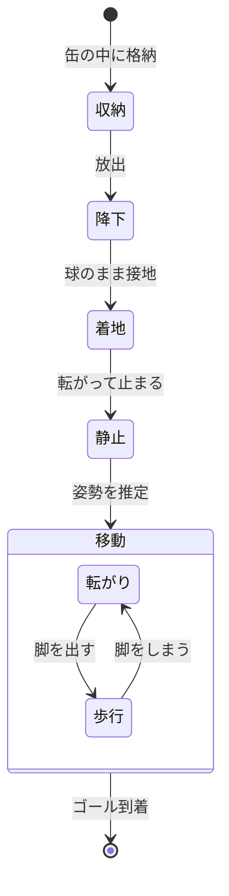
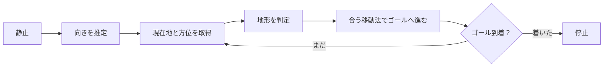

CanSatで、完全球体で、多脚の機体を作りたい。

> [!warning] このノートについて
> 冒頭の一文が出発点。論点の洗い出しと概算は AI（Claude）との対話で整理したもので、まだ何も決まっていない。
> 数値は目安で、※要確認 が付くものは大会レギュレーションやデータシートでの確認が必要。

---

## 動きのイメージ

## 「球」と「多脚」は相性が悪い

- 球は殻に**隙間がないほど**きれい。脚は殻を**突き破らないと**出られない。
- 球は内側の形が丸いので、四角い部品（サーボ、基板、電池）を詰めるほど隙間が余る。
- 脚が増えるほどアクチュエータが増え、球の中がそれで埋まる。

でも、ここが一番面白いところ。**閉じれば継ぎ目も見えない球、開くと生き物**、というギャップを作りたい。

> [!question] 「完全球体」の線引き
> 閉じた状態で球ならOKか、継ぎ目（スリット）はどこまで許すか。
> ここを先に決めないと、機構の選択肢が絞れない。

## 上下がない、という設計

球はどの向きで止まるか分からない。逆に言えば、**脚を全方向に対称に配置すれば、上下の概念を捨てられる**。ひっくり返っても、そのまま歩ける機体になる。

代償として、常に上半分の脚は地面に届かず遊ぶ。正多面体の頂点に脚を置くとして、ざっくり比べるとこうなる。

| 配置 | 脚の本数 | サーボ数（1脚2自由度） | 所感 |
| :--- | ---: | ---: | :--- |
| 正四面体 | 4 | 8 | 接地3本、持ち上げると倒れる。歩くより転がる動きになりそう |
| 正八面体 | 6 | 12 | 横向きの4本で歩けそう。本命？ |
| 立方体 | 8 | 16 | 4本接地で安定、4本遊ぶ |
| 正二十面体 | 12 | 24 | ロマン枠。缶サイズでは絶望的 |

## 脚のしまい方

| 方式 | 中身 | 球のきれいさ | 懸念 |
| :--- | :--- | :---: | :--- |
| A. 殻＝脚 | 殻を花びら状に分割し、殻そのものを脚にする | ◎ | 曲面の板は脚として細く作りにくい |
| B. 殻がハッチ | 殻が開いて、中から脚が伸びる | ○ | 脚の収納スペースとハッチの駆動が別に要る |
| C. 表面に沿わせる | 球面の溝に脚を巻き付けて収納 | △ | 溝が見える。着地の衝撃を脚が直接受ける |

変形する球型の先例としては SORA-Q（LEV-2）がある。あちらは車輪のような走行で、多脚ではない。※要確認

## サイズの現実

CanSat の定番枠を φ66 × 115 mm、350 g とする。※要確認（大会・クラスで違う）

$$
\frac{V_\text{球}}{V_\text{缶}}
= \frac{\frac{4}{3}\pi (33)^3}{\pi (33)^2 \times 115}
\approx \frac{151\ \text{cm}^3}{393\ \text{cm}^3}
\approx 38\%
$$

- 缶に球を入れた時点で、**体積の6割を捨てる**ことになる。余った上下の空間にパラシュートを逃がすのはアリかも。
- 350 g まで積むには平均密度 $2.3\ \text{g/cm}^3$ が必要。つまり**質量より先に体積が尽きる**。
- SG90 クラスのサーボ（約 23 × 12 × 29 mm）を12個入れると、それだけで約 39 cm³、球の4分の1。詰める隙間を考えると実質もっと厳しい。※要確認

> [!tip] 逃げ道
> 缶サイズの制約を外せるクラス（オープンクラス等）を狙うか、脚を減らすか、ワイヤー駆動にしてサーボを中央にまとめるか。

## ミッション：ゴールまで歩く

→ 決定。着地点から、自分の脚でゴールまで歩く。

問題は、どこまで歩けるか。仮の数字で見積もる。※すべて仮定

- 歩く速さ：歩幅 3 cm × 2 歩/秒 = 6 cm/s
- 消費電力：サーボ12個 × 5 V × 0.15 A = 9 W
- 電池：18650 を1本で約 10 Wh、体積は約 16.5 cm³（球の1割強）

$$
\frac{10\ \text{Wh}}{9\ \text{W}} \approx 1.1\ \text{h}
\quad\Rightarrow\quad
0.06\ \text{m/s} \times 4000\ \text{s} \approx 240\ \text{m}
$$

> [!warning] ==歩ける距離は数百 m が上限==
> 1 km 歩くなら約4.6時間、電池は4本以上。それだけで球の4割を超える。
> 着地点からゴールまでの距離が数 km になる大会だと、缶サイズのままでは届かない。

## 地形で移動法を切り替える

→ 決定。歩くのも転がるのも両方できるようにして、地形に合う方を選ぶ。

| 地形 | 移動法 | 理由 |
| :--- | :--- | :--- |
| 硬い平地 | 転がる | 速くて電力も少なく済むはず |
| 下り坂 | 転がる | 重力まかせ。ただし止まれる必要がある |
| 急な上り坂 | 歩く | 球は転がり落ちる。脚で踏ん張る |
| 段差・石 | 歩く | 球は引っかかる。脚で越える |
| 砂地 | 要実験 | 転がると沈む？ 歩いても脚が埋まる？ |
| ゴール直前 | 歩く | 位置を細かく合わせる |

> [!question] どうやって転がるか
> - **脚で蹴る**：追加の部品なしで済むが、回転に合わせて順番に蹴る制御が難しい
> - **重心を動かす**：中のおもりを振り子にする。滑らかに転がるが、貴重な体積と質量を使う
>
> 球の中に余裕がないので、まず脚で蹴る案から考えたい。

### 地形をどう判定するか

カメラなしでも、手持ちのセンサでそれなりに分かりそう。

- **IMU**：傾きで坂、振動で路面の荒さ
- **サーボ電流**：脚への負荷で、踏ん張りや引っかかりを検知
- **GPS の進み具合**：動いているのに進まないなら、スタックしている

### 切り替えの注意点

切り替えには時間も電力もかかる。境界の地形で歩行と転がりを行ったり来たりすると、一番もったいない。

シュミットトリガと同じで、**切り替える閾値にヒステリシスを持たせる**のがよさそう。

> [!warning] 転がると座標系も回る
> 転がっている間は機体そのものが回転するので、アンテナの向きも地磁気センサの軸も変わり続ける。
> 位置と方位の取得は、止まった瞬間にまとめてやる形になるかも。

## 考えたいこと

- [x] 何のために歩くのか → ゴールまで歩く
- [x] 移動法 → 歩くのも転がるのも両方、地形で切り替え
- [ ] 転がる駆動方式（脚で蹴る or 重心移動）
- [ ] 転がりの消費電力の実測と、航続距離の見直し
- [ ] 狙う大会とクラス（ここでサイズが決まる）
- [ ] 着地点からゴールまでの想定距離、路面（砂地？ 草地？）
- [ ] ゴール付近の位置精度。GPSだけで足りるか
- [ ] 脚の本数と配置
- [ ] パラシュートの置き場所と、着地後の切り離し
- [ ] 着地衝撃。脚の展開機構が壊れないか
- [ ] どの向きで止まったかの推定（IMUで足りるか）
- [ ] 通信・GPS のアンテナをどこに置くか（殻は樹脂なら透過できる？）
- [ ] 球殻の作り方。[[3Dプリンター|自作3Dプリンター]]で出せる精度か
- [ ] 多チャンネルの同時駆動。3Dプリンターと同じく FPGA に任せるか、マイコン＋PWMドライバで済ませるか
